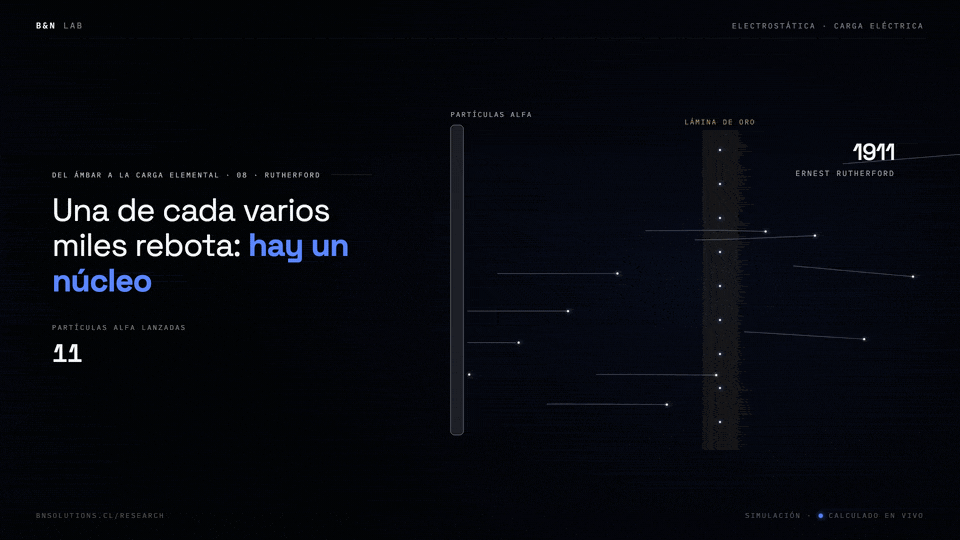
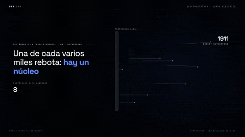
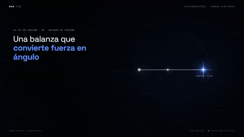
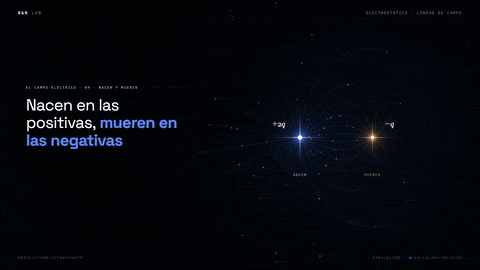
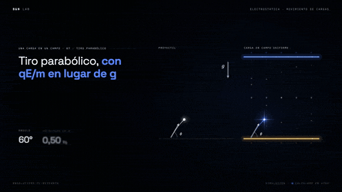
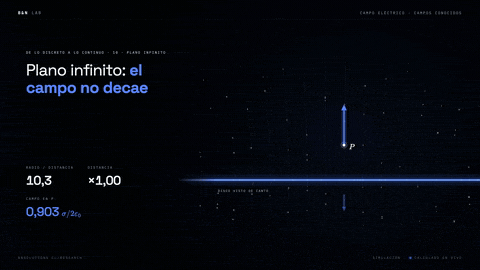
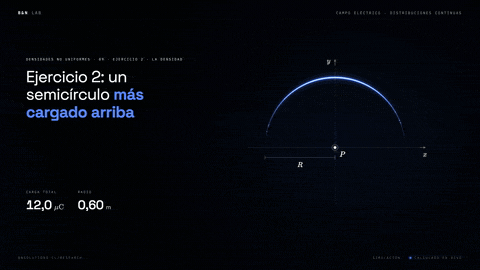

  

  <a href="apuntes/"><b>Apuntes en PDF</b></a> &nbsp;·&nbsp;
  <!-- TODO: reemplazar por la lista de reproducción de YouTube cuando esté publicada -->
  <a href="TODO-lista-youtube"><b>Ver la serie</b></a> &nbsp;·&nbsp;
  <a href="../README.md"><b>Física</b></a> &nbsp;·&nbsp;
  <a href="../../../README.md"><b>Todas las clases</b></a>

Seis clases animadas de electrostática, de la carga eléctrica a las distribuciones continuas. Siguen, sección por sección, los apuntes y las demostraciones de Javier Patiño para el curso de Electricidad y Magnetismo (CFSA3440), que se publican aquí junto a ellas. Cada clase dura cerca de tres minutos y existe en 4:5, 16:9 y 9:16.

### `// 01` Las clases

<table>
  <tr>
    <td width="50%" valign="top"> <b>1 · <a href="01-del-ambar-a-la-carga-elemental/">Del ámbar a la carga elemental</a></b> La historia de la carga, de Tales a Millikan: dos signos, conservación y cuantización.</td>
    <td width="50%" valign="top"> <b>2 · <a href="02-la-ley-de-coulomb/">La ley de Coulomb</a></b> La balanza de torsión, los tres hallazgos, la forma vectorial, la gravitación y la superposición.</td>
  </tr>
  <tr>
    <td width="50%" valign="top"> <b>3 · <a href="03-el-campo-electrico-y-sus-lineas/">El campo eléctrico y sus líneas</a></b> De la acción a distancia a Faraday y Maxwell; la definición de campo y dónde se anula.</td>
    <td width="50%" valign="top"> <b>4 · <a href="04-una-carga-en-un-campo/">Una carga en un campo</a></b> Una carga suelta en un campo uniforme: q/m, la parábola y el electrón frente a la gravedad.</td>
  </tr>
  <tr>
    <td width="50%" valign="top"> <b>5 · <a href="05-de-lo-discreto-a-lo-continuo/">De lo discreto a lo continuo</a></b> De la suma a la integral y las seis demostraciones de campos conocidos. El reel original de la serie.</td>
    <td width="50%" valign="top"> <b>6 · <a href="06-densidades-no-uniformes/">Densidades no uniformes</a></b> La receta de siete pasos y dos ejercicios guiados con densidad variable.</td>
  </tr>
</table>

| # | Clase | Apuntes | Duración | Video |
|---|---|---|---|---|
| 1 | [Del ámbar a la carga elemental](01-del-ambar-a-la-carga-elemental/) | Clase 1, §4 y §5 | 2:58 | `TODO` |
| 2 | [La ley de Coulomb](02-la-ley-de-coulomb/) | Clase 1, §6 a §8 | 2:58 | `TODO` |
| 3 | [El campo eléctrico y sus líneas](03-el-campo-electrico-y-sus-lineas/) | Clase 1, §9 a §10.3 | 2:55 | `TODO` |
| 4 | [Una carga en un campo](04-una-carga-en-un-campo/) | Clase 1, §10.4 a §12 | 2:40 | `TODO` |
| 5 | [De lo discreto a lo continuo](05-de-lo-discreto-a-lo-continuo/) | Demostraciones de campos conocidos | 2:48 | `TODO` |
| 6 | [Densidades no uniformes](06-densidades-no-uniformes/) | Clase 2, §2 a §4 y §6 | 2:40 | `TODO` |

### `// 02` Los apuntes

La carpeta [`apuntes/`](apuntes/) tiene el material de Javier Patiño en el que se basa la serie:

| Archivo | Qué es |
|---|---|
| [`Apuntes_Electricidad_13-10_Anexo_Revisado.pdf`](apuntes/Apuntes_Electricidad_13-10_Anexo_Revisado.pdf) | Apuntes de Electricidad y Magnetismo, clases 1 y 2: historia de la carga, ley de Coulomb, superposición, campo eléctrico y distribuciones continuas, con ejemplos resueltos. |
| [`Demostraciones_Campos_Conocidos.pdf`](apuntes/Demostraciones_Campos_Conocidos.pdf) | Las seis demostraciones de campos conocidos (arco, anillo, disco, plano, barra en su eje y en su mediatriz) y la barra infinita, paso a paso. |
| [`Demostraciones_Campos_Conocidos.tex`](apuntes/Demostraciones_Campos_Conocidos.tex) | El archivo principal del fuente LaTeX de las demostraciones (preámbulo, estilos y portada). |

Los apuntes no están bajo la licencia MIT del código: son de su autor y se publican con su autorización, con fines educativos. Las condiciones están en [`apuntes/LEEME.md`](apuntes/LEEME.md).

### `// 03` A quién va dirigido

- **Estudiantes de un primer curso de Electricidad y Magnetismo**, en ingeniería o ciencias, que quieran ver funcionando lo que leen en los apuntes. Basta con mecánica de Newton, vectores y cálculo de una variable; las integrales aparecen recién en las clases 5 y 6.
- **Profesores y ayudantes** que quieran proyectar una clase, usar una escena suelta o renderizar un cuadro para una guía. Cada cifra en pantalla sale de una cuenta en el código, así que se puede revisar.
- **Quien quiera hacer clases animadas** de otro tema: cada carpeta es un proyecto completo y la [plantilla](../../../plantilla/) explica cómo partir uno nuevo.

### `// 04` Cómo está hecha cada clase

Cada carpeta es un proyecto [Remotion](https://www.remotion.dev) con las composiciones `Clase` (4:5), `ClaseYT` (16:9) y `ClaseTT` (9:16). El guion vive en `audio/generar_voz.py`, una frase por escena; la voz se genera desde ahí y entrega el momento de cada palabra, y las animaciones se anclan a esas palabras. Las simulaciones se dibujan en canvas con el motor de `src/lab/` y las cifras del HUD se calculan en cada cuadro. El README de cada clase trae las escenas, el guion completo y los comandos para renderizarla.

### `// 05` Equipo

| | |
|---|---|
| **Nicolás Moreno** [@4mser](https://github.com/4mser) | Cofundador de B&N Solutions e ingeniero de software. Desarrolla el motor de animación, las simulaciones y los videos. |
| **Benjamín Campos** [@B3njjaman](https://github.com/B3njjaman) | Cofundador de B&N Solutions e ingeniero físico. Creó el reel original de la serie y su motor de simulación. |
| **Javier Patiño** | Licenciado en Física y profesor de Electricidad y Magnetismo. Autor de los apuntes en que se basan las clases y la voz de B&N Lectures. |

---

  

